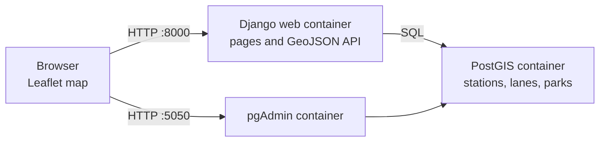
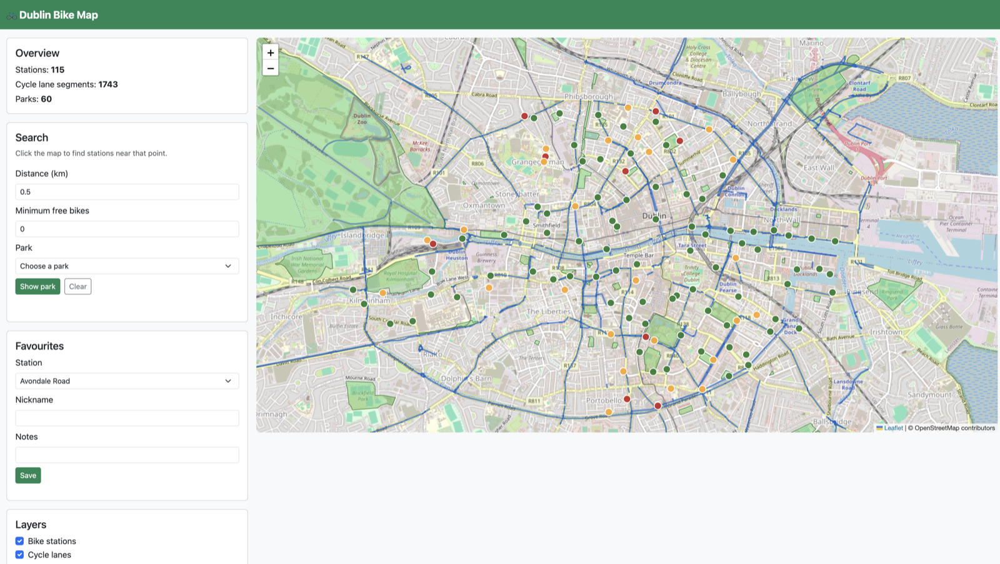

# Dublin Bike Map

A map of Dublin Bikes stations, cycle lanes, and parks. You can click the map to find stations near a point, pick a park to see stations beside it and lanes that cross it, and save a favourite station.

This is a location-based services app for the CMPU module. It uses Django, PostGIS, and Leaflet, and it runs in Docker on your own computer.

## Features

- 115 Dublin Bikes stations, shown as points. Green means 5 or more bikes are free, amber means 1 to 4, and red means none.
- Cycle lanes from OpenStreetMap, shown as lines.
- 60 named parks, shown as polygons.
- Click the map to find stations within a chosen distance.
- Pick a park to find stations within 200 metres, and the lane segments that cross the park.
- Save, edit, and delete a favourite station.

## Technology

- Django and Django REST Framework, with GeoJSON from `djangorestframework-gis`
- PostgreSQL and PostGIS
- Leaflet and OpenStreetMap tiles
- Bootstrap 5
- Docker Compose: Django, PostGIS, and pgAdmin

## How to run it

You need Docker Desktop. From this folder:

```bash
cp .env.example .env
```

Open `.env` and set your own `POSTGRES_PASSWORD`, `PGADMIN_DEFAULT_PASSWORD`, and `DJANGO_SECRET_KEY`. Do not commit `.env`.

```bash
docker compose up -d --build
docker compose exec web python manage.py migrate
docker compose exec web python manage.py load_data
```

Then open:

- Map: http://localhost:8000
- API: http://localhost:8000/api/
- pgAdmin: http://localhost:5050 (email and password are in `.env`)

To refresh the bike numbers and map data:

```bash
docker compose exec web python scripts/fetch_data.py
docker compose exec web python manage.py load_data
```

`fetch_data.py` downloads stations from the Dublin Bikes feed and lanes and parks from OpenStreetMap. The OpenStreetMap servers are sometimes slow.

To run the API checks:

```bash
docker compose exec web python tests/test_api_endpoints.py
```

## How to use the map

1. Open http://localhost:8000. The map opens on Dublin city centre.
2. Tick or untick **Bike stations**, **Cycle lanes**, and **Parks** to show or hide each layer.
3. Click a station, lane, or park for its details.
4. Click an empty part of the map. The app lists stations within the **Distance (km)** box. Purple markers are the matches.
5. Change **Minimum free bikes** to hide stations that do not have enough bikes.
6. Choose a park and click **Show park**. The map zooms to the park, lists stations within 200 metres, and draws crossing lanes in orange.
7. Click **Clear** to remove the search.
8. Under **Favourites**, pick a station, type a nickname, and click **Save**. Use **Edit** and **Delete** on the list. You can also click **Save favourite** in a station popup.

## API

Station, lane, and park lists are GeoJSON. A favourite list is normal JSON.

| What | URL |
|---|---|
| All stations | `GET /api/stations/` |
| Stations with at least 5 bikes | `GET /api/stations/?min_bikes=5` |
| Stations near a point | `GET /api/stations/nearby/?lat=53.35&lng=-6.26&distance=0.5` |
| Stations inside a park | `GET /api/stations/in_park/?park_id=119` |
| Stations within 200 m of a park | `GET /api/stations/near_park/?park_id=119&distance=200` |
| Lanes that cross a park | `GET /api/lanes/through_park/?park_id=116` |
| All lanes | `GET /api/lanes/` |
| All parks | `GET /api/parks/` |
| Favourites | `GET /api/favourites/` |
| Create a favourite | `POST /api/favourites/` with `station`, `nickname`, and `notes` |
| Update a favourite | `PUT /api/favourites/<id>/` |
| Delete a favourite | `DELETE /api/favourites/<id>/` |

`distance` on `nearby` is kilometres. `distance` on `near_park` is metres. `nearby` and `near_park` add `distance_m` to each station. Park ids change if you reload the park data, so read them from `/api/parks/`.

Creating or changing a favourite from the browser needs the page's CSRF token. The map page sends it for you.

## Architecture

The browser loads the map page and then asks the Django API for GeoJSON. Django reads PostGIS and sends the features back. Leaflet draws them on OpenStreetMap tiles. pgAdmin is only for looking at the database.



`compose.yaml` puts the three containers on one Docker network. The web container reaches the database at the host name `db`. Passwords come from `.env` and are not written in the code.

## Database

All coordinates use SRID 4326, which is normal GPS latitude and longitude. Django creates a spatial index on each geometry column.

| Table | Geometry | Main fields |
|---|---|---|
| `bikes_station` | Point `location` | `station_id`, `name`, `address`, `bike_stands`, `available_bikes` |
| `bikes_cyclelane` | Line `path` | `name`, `lane_type` |
| `bikes_park` | MultiPolygon `area` | `name` |
| `bikes_favouritestation` | none | `station` (foreign key), `nickname`, `notes`, `created_at` |

The migration is `bikes/migrations/0001_initial.py`.

The three location searches are:

- **Near a point:** `location__distance_lte` on stations, ordered by distance.
- **Inside or beside a park:** `location__within` for stations inside the polygon, and `location__distance_lte` for stations within a set distance of the park edge.
- **Crossing a park:** `path__intersects` on cycle lanes.

## Screenshot



## Known limits

- Bike counts are from the last time `fetch_data.py` was run. They are not live.
- Dublin Bikes stations are on streets, so "stations inside a park" is usually empty. "Within 200 m of a park" is the useful search.
- Some parks, including St Stephen's Green, have no cycle lane drawn through them in OpenStreetMap.
- One station in the Dublin Bikes feed has no name. The loader uses its address instead.
- Deployment is local Docker only. There is no public web address.

## Credits

- The Docker setup, Leaflet page layout, and nearby-search pattern come from the Week 5 and Week 6 lab exercises for this module.
- Station data: [Dublin Bikes GBFS feed](https://data.gov.ie/dataset/dublinbikes-api), Dublin City Council / Smart Dublin, Creative Commons Attribution 4.0.
- Cycle lanes and parks: © OpenStreetMap contributors, via the Overpass API. Data is available under the [Open Database Licence](https://www.openstreetmap.org/copyright).
- Map tiles: © OpenStreetMap contributors.
